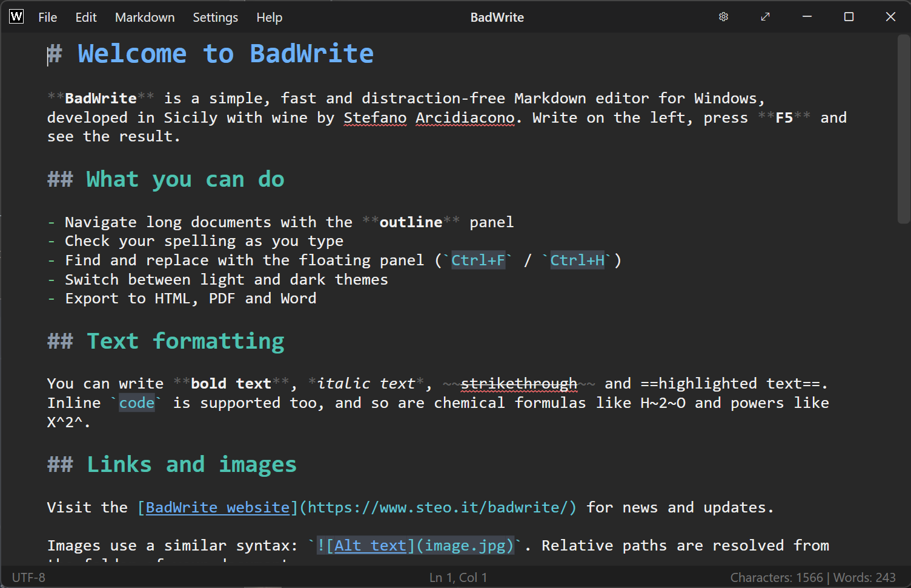
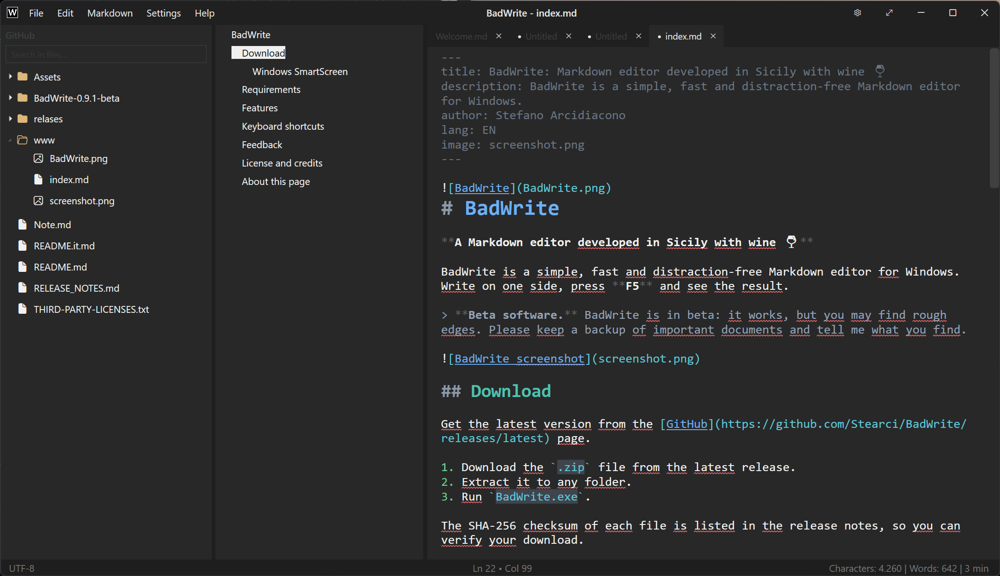
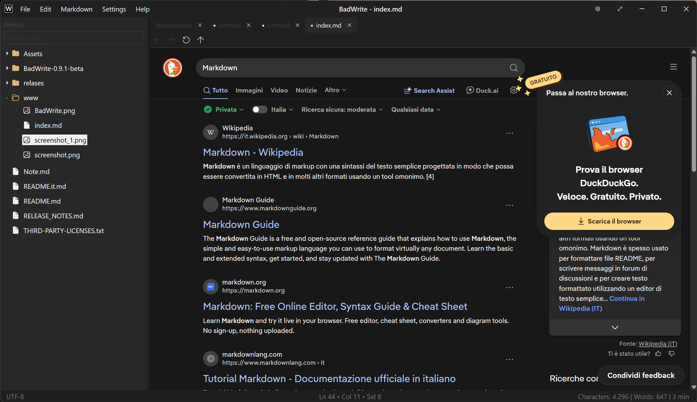

# BadWrite

**Un editor Markdown e gestore di note sviluppato in Sicilia con del buon vino.**

BadWrite è un editor Markdown per Windows semplice, veloce e senza distrazioni. Scrivi da una parte, premi **F5** e guarda il risultato.

🇬🇧 [Read in English](README.md) · 🌐 [Sito web](https://www.steo.it/badwrite/)

> **Software in beta.** BadWrite è in versione beta: funziona, ma può avere qualche bug. Tieni una copia di sicurezza dei documenti importanti e segnalami quello che trovi (vedi [Segnalazioni](#segnalazioni)).

## Download

Scarica l'ultima versione dalla pagina [**Releases**](../../releases).

1. Scarica il file `.zip` dell'ultima release.
2. Estrailo in una cartella qualsiasi.
3. Avvia `BadWrite.exe`.

Il checksum SHA-256 di ogni file è riportato nelle note di rilascio, così puoi verificare il download.

### Windows SmartScreen

BadWrite non è ancora firmato digitalmente, quindi la prima volta Windows può mostrare *"Windows ha protetto il PC"*. Fai clic su **Altre informazioni → Esegui comunque**. Prima di avviarlo puoi confrontare il checksum con quello delle note di rilascio.

## Requisiti

* Windows 10 o 11 (64 bit)
* [.NET 10 Desktop Runtime](https://dotnet.microsoft.com/download/dotnet/10.0) (x64, se non è già installato)
* Microsoft Edge WebView2 Runtime (già presente in Windows 11 e in Windows 10 aggiornato)

## Funzioni

**Scrittura**

* Colorazione della sintassi Markdown mentre scrivi
* Continua automaticamente elenchi e liste di attività quando premi Invio
* Inserimento di tabelle e formattazione automatica (`Ctrl+Shift+T`)
* Trascina le immagini nel documento
* Cerca e sostituisci con un pannello flottante (`Ctrl+F` / `Ctrl+H`)
* Modalità focus (`F8`) e modalità macchina da scrivere (`F9`)
* Schermo intero con orologio (`F11`)
* Ricerca porole sul WEB

**Navigazione**

* Pannello struttura per muoverti nei documenti lunghi
* Pannello Explorer per un'intera cartella di appunti, con ricerca nel testo

**Correttore ortografico**

* Correzione mentre scrivi, con suggerimenti e dizionario personale
* Dizionari Hunspell (`.dic` / `.aff`): il dizionario italiano è incluso e puoi aggiungere altre lingue copiandole nella cartella `Dictionaries`

**Anteprima ed esportazione**

* Anteprima HTML sincronizzata con il cursore (`F5`)
* Esportazione in pagina HTML (con scelta del tema e copia opzionale delle immagini), codice HTML, PDF e DOCX
* Copia negli appunti l'HTML del documento o della selezione
* Stampa

**Aspetto**

* 11 temi, tra cui Dark, Coffee, Midnight Blue, Sky Blue, Forest, Sepia, Solarized (chiaro e scuro), Nord e Antique Rose, più *Automatico* che segue Windows

**File**

* Riconoscimento automatico della codifica del testo (UTF-8, ANSI, UTF-16) e possibilità di riaprire o salvare con un'altra
* Salvataggio automatico e recupero del testo non salvato al riavvio
* File e cartelle recenti

## Scorciatoie da tastiera

|Scorciatoia|Azione|
|-|-|
|`F5`|Anteprima sì/no|
|`F8` / `F9`|Modalità focus / macchina da scrivere|
|`F11`|Schermo intero|
|`Ctrl+N` / `Ctrl+Shift+N`|Nuovo documento / Nuova finestra|
|`Ctrl+O`|Apri|
|`Ctrl+S` / `Ctrl+Shift+S`|Salva / Salva con nome|
|`Ctrl+F` / `Ctrl+H`|Cerca / Sostituisci|
|`Ctrl+B` / `Ctrl+I` / `Ctrl+K`|Grassetto / Corsivo / Codice|
|`Ctrl+Shift+T`|Formatta tabella|
|`Ctrl+Shift+H`|Copia HTML negli appunti|

## Segnalazioni

Questa è una beta e le tue segnalazioni servono a migliorarla.

* Hai trovato un errore o hai un'idea? Apri una [issue](../../issues).

Quando segnali un errore, indica la versione di BadWrite (in **Help → About**), la versione di Windows e i passaggi per riprodurlo.

## Licenza e crediti

BadWrite è © Stefano Arcidiacono. È gratuito, ma non open source: tutti i diritti
sono riservati. Ti chiedo di non ridistribuire versioni modificate; per condividere
BadWrite, linka questa pagina.

BadWrite usa componenti open source, elencati con le rispettive licenze in [`THIRD-PARTY-LICENSES.txt`](THIRD-PARTY-LICENSES.txt) e in **Help → About**: AvalonEdit, Markdig, Open XML SDK, HtmlToOpenXml, AngleSharp, Microsoft.Data.Sqlite, WebView2, WeCantSpell.Hunspell e i dizionari di LibreOffice.

